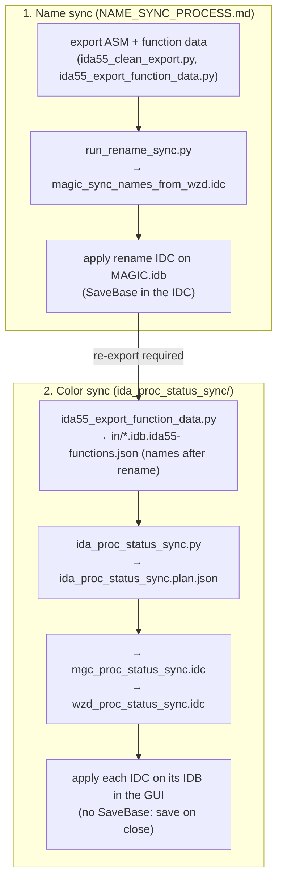

# Color Sync Process (with Name Sync)

Last checked against the code: 2026-11-10.

## Purpose

Some functions exist in both MAGIC.exe and WIZARDS.exe. When such a function has been marked completed
in one IDB, mark it completed in the other as well.

- "Completed" is the IDA function color `00FFFF80` (`0xBBGGRR`; `DEFAULT_COMPLETED_COLOR_HEX` in `ida_proc_status_sync/status_plan.py`).
- The color is set by hand in IDA. This process only spreads it.

The color sync is its own process. It is **not** a preprocess for the name mapping. It **depends on the name
sync**, because it matches functions by name.

## Why the name sync comes first

The sync matches functions by exact name only:
- `status_plan.py:39` `node_key` = `(game, name)`
- `status_plan.py:135` `"join_key": "name"`
- the generated IDC finds each function with `LocByName` (`generate_status_idc.py:53`)

So a MGC function counts as "the same function" as a WZD one only if they have the same name. Making that true
is what the WZD → MGC name sync does ([NAME_SYNC_PROCESS.md](NAME_SYNC_PROCESS.md), Part A).

If the color sync runs on names from before the rename:
- a MGC duplicate still under its old name is not grouped with its WZD original, so it is not colored;
- once the rename IDC has been applied, the color IDC's `LocByName` of the old name logs `missing`.

## Rule

`build_status_plan`, `status_plan.py:72-145`:
1. Group every MGC and WZD function by name.
2. If **any** member of a group has color `00FFFF80`, the group is completed.
3. Every member of a completed group that is not `00FFFF80` gets an update to `00FFFF80`.

The rule only adds the completed color; it never removes it. A name that occurs once is a group of one and
is never changed.

## Flow (name sync, then color sync)



The export writes the `.json` itself (`piethawn_sync/function_dump.py`); there is no separate conversion step.
The old `build_status_sync_plan.cmd`/`.sh` runner is in `DEPRECATED/`.

## Commands (repo root)

```powershell
# 1. Name sync: see NAME_SYNC_PROCESS.md, through applying magic_sync_names_from_wzd.idc.

# 2. Color sync. Close every IDA window first. Re-export both IDBs (.json into in\; IDA runs on work copies), then build the plan and IDCs.
c:/python314/python.exe -B .\ida_proc_data_export\ida55_export_function_data.py
c:/python314/python.exe -B .\ida_proc_status_sync\ida_proc_status_sync.py

# 3. Apply, one IDB at a time, in the IDA GUI (File > IDC file...):
#    MAGIC.idb   <- ida_proc_status_sync\mgc_proc_status_sync.idc
#    WIZARDS.idb <- ida_proc_status_sync\wzd_proc_status_sync.idc
#    These IDCs call neither SaveBase nor Exit(): choose Save when closing IDA.
```

Each status IDC writes a log beside its IDB with one line per entry: `updated`, `already-set`, `missing` or
`setcolor-failed`.

## Current numbers (`ida_proc_status_sync/ida_proc_status_sync.plan.json`)

| | MAGIC | WIZARDS |
|---|---|---|
| Functions | 1207 | 3808 |
| Completed (`00FFFF80`) | 259 | 974 |
| Pending color updates | 142 | 71 |

There are 4157 name groups in total, and 1145 of them are completed.

**Verify:** run step 2 again after applying. Both update counts should be 0, apart from
`missing` entries, which point to a name problem for the name sync to resolve.

## No one-shot script

Rename and recolor cannot be regenerated in one pass. The rename IDC has to be applied in IDA before the
color plan is built; otherwise the plan uses names from before the rename. Run them as two passes:

1. Regenerate and apply the rename IDC.
2. Then re-export, regenerate and apply the color IDCs.

`remom-resync.py`, which tried to do both in one run, has been removed.
