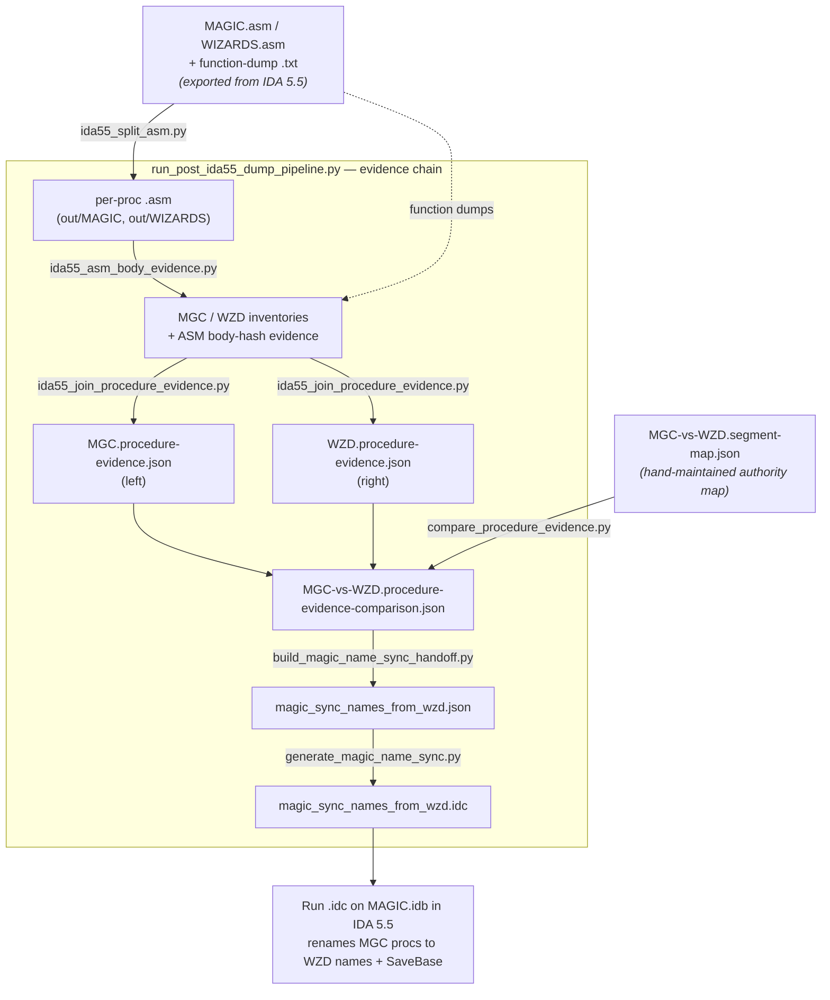

ReMoM-ReSync.md

old pipelines
    1. hash-chain
    2. evidence-chain

As of 202607241528, ...
start new process, what for combining the two previous efforts

To-Do, ..., Done.

rename functions in MAGIC
rename functions in WIZARDS
recolor functions in MAGIC
recolor functions in WIZARDS
rename functions in To-Do-List
check-off functions in To-Do-List

Recommended: GUI
Open C:\STU_DASM\IDA55_MOM131\MAGIC.idb in IDA (idag.exe). Make sure no other IDA is on that DB.
File → Script file… (Alt+F7) → pick ida_proc_name_sync/magic_sync_names_from_wzd.idc.
Watch the Output window. Each entry logs one of renamed / already-synced / collision / name-mismatch / not-found, ending with:

magic-name-sync-summary,attempted=20,ok=N,failed=M
The script's Exit(0) then closes IDA. When prompted to save / pack the database, choose Yes.
Reopen MAGIC.idb and confirm (Jump to name → Shear_Bitmap_Y, or check any renamed symbol). Because step 4 closed IDA, this reopen is your verification that the save stuck.
Expect ok around 20 minus a few already-synced — several of these names may already be applied from prior sessions, which is a success, not a failure.

C:\STU\devel\STU-Extras\Piethawn\Piethawn\ida_proc_name_sync\magic_sync_names_from_wzd.idc

Wha?
C:\STU\devel\STU-Extras\Piethawn\Piethawn\ida_proc_name_sync_prereq\MGC-vs-WZD.procedure-evidence-comparison.json

It's produced by compare_procedure_evidence.py, and the whole chain is orchestrated by run_post_ida55_dump_pipeline.py (steps at lines 246–249). Here's the lineage, from IDA back-end to that file:


MAGIC.asm / WIZARDS.asm + function-dump .txt   ← exported from IDA 5.5
        │  ida55_split_asm.py            (split into per-proc .asm)
        │  ida55_asm_body_evidence.py    (hash each proc body)
        ▼
  MGC/WZD inventories + body-hash evidence
        │  ida55_join_procedure_evidence.py
        ▼
  MGC.procedure-evidence.json   (left)
  WZD.procedure-evidence.json   (right)
        │  compare_procedure_evidence.py  ── + MGC-vs-WZD.segment-map.json
        ▼
  MGC-vs-WZD.procedure-evidence-comparison.json   ◄── the file you asked about
        │  build_magic_name_sync_handoff.py
        ▼
  magic_sync_names_from_wzd.json
        │  generate_magic_name_sync.py
        ▼
  magic_sync_names_from_wzd.idc
  


Two parts: regenerate the scripts from source (terminal), then apply in IDA.

1. Regenerate the .json + .idc from the comparison data (run from the repo root, c:\STU\devel\STU-Extras\Piethawn\Piethawn):

c:/python314/python.exe ida_proc_name_sync_prereq/build_magic_name_sync_handoff.py

c:/python314/python.exe ida_proc_name_sync/generate_magic_name_sync.py

C:\STU\devel\STU-Extras\Piethawn\Piethawn\ida_proc_name_sync\magic_sync_names_from_wzd.idc


### Pending Review:
    C:\STU\devel\STU-Extras\Piethawn\Piethawn\IDA55_IDC_NOTES.md
        - `python3 rasm_sync_translations.py` audits translated `.c` files against current split `.asm` files and the Gemini checklist in `HOWTO-DasmRasmPipeline.md`. It does not update `stub_wip_todo.md`; that file tracks IDA completion flags for MGC/WZD, not Gemini translation completion.
        C:\STU\devel\STU-Extras\Piethawn\Piethawn\HOWTO-DasmRasmPipeline.md

    C:\STU\devel\ReMoM\doc\__TODO-ProjectOverview.md

    C:\STU\devel\ReMoM\doc\#TODO\stub_wip_todo.md


##### Here's a common set for checklist/todo states:

State	Emoji	Code
To do / not started	⬜	:white_large_square:
Pending / in progress	🟡	:yellow_circle:
Done	✅	:white_check_mark:
A fuller palette if you want finer states:

To do: ⬜ :white_large_square: · ☐ (U+2610) · 🔲 :black_square_button: · ⭕ :o:
Pending / in progress / blocked: 🟡 :yellow_circle: · 🔄 :arrows_counterclockwise: · ⏳ :hourglass_flowing_sand: · 🚧 :construction: · 🔴 :red_circle: (blocked)
Done: ✅ :white_check_mark: · ☑️ :ballot_box_with_check: · ✔️ :heavy_check_mark: · 🟢 :green_circle:
Won't do / cancelled: ❌ :x: · ⛔ :no_entry: · 🚫 :no_entry_sign:
A clean three-state convention that renders well in Markdown and plain text:


- ⬜ To do
- 🟡 Pending / in progress
- ✅ Done

PS. HOWTO-DasmRasmPipeline.md already uses GitHub-style [ ] / [x] task boxes — those render as real checkboxes on GitHub.


---

## Addendum: Name-Sync Pipeline Diagram

Direction is one-way by design (per `WZD_TO_MGC_PROCEDURE_NAME_SYNC_PRD.md`): **WZD is the naming authority, MGC is the rename target.** Nothing renames WZD from MGC. The only hand-maintained input is the segment map; everything else is derived from the IDA 5.5 dumps and regenerated by `run_post_ida55_dump_pipeline.py`. Edge labels are the scripts that produce each artifact.



Regenerate everything from source (repo root):

```powershell
c:/python314/python.exe run_post_ida55_dump_pipeline.py
```
