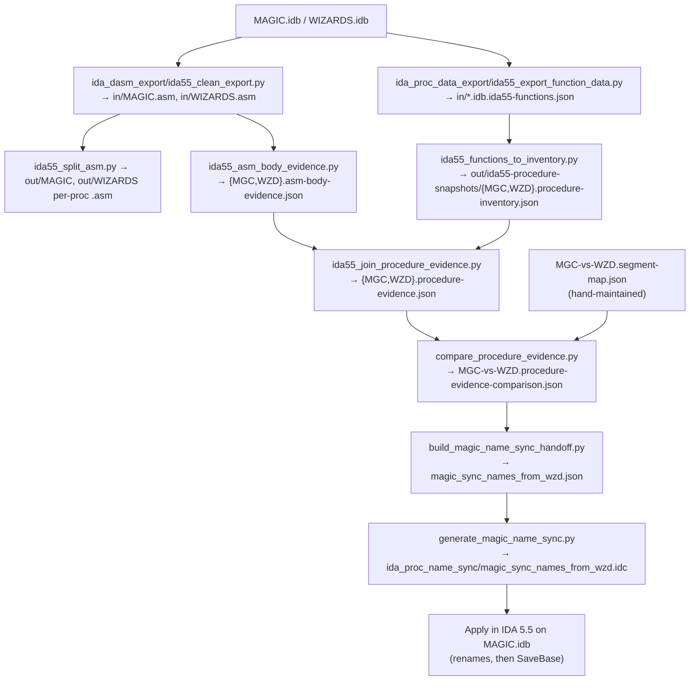

No, there is no single regular expression that can reliably match every valid C function definition.
C is a context-free language, meaning its grammar allows for arbitrary nesting and complex structures that standard regular expressions (which only recognize regular languages) cannot parse. While a trivial regex like .* technically matches everything, a regex designed to isolate only valid C function definitions will always break on valid edge cases.

Why Regex Fails on C Functions

• Arbitrary nesting. Function parameters and bodies can contain nested parentheses, brackets, and braces, such as function pointers (int (*foo(int (*bar)(int)))(char)) or array sizes with expressions. Standard regular expressions cannot count balanced parentheses to arbitrary depths.
• K&R (old-style) definitions. Valid C still allows ancient parameter declarations where types are listed between the closing parenthesis and the opening brace, like int foo(a, b) int a; char b; { ... }.
• Preprocessor macros and directives. Macros can hide parentheses, return types, or entire function signatures (e.g., MY_FUNC_MACRO(foo) { ... }), and #ifdef blocks can split a single function signature into multiple branches.
• Comments and string literals. A comment like /* ) { */ or a string literal containing braces inside a default argument expression or sizeof can trick a regex into thinking a function header ended early.
• Function pointers vs. definitions. Complex return types, such as a function returning a pointer to a function (void (*signal(int sig, void (*func)(int)))(int)), look completely different from standard return_type name(params) patterns.

A "Good Enough" Heuristic Regex

If you are analyzing clean, modern C code without heavy macro obfuscation—for example, to build a quick syntax highlighter or code indexer—you can use a heuristic pattern.
In PCRE (Perl-Compatible Regular Expressions, used in Python, VS Code, ripgrep, etc.), you can use recursive subpatterns (?R) to handle balanced parentheses:

```
(?m)^[ \t]*(?:[a-zA-Z_]\w*[\s\*]+)+([a-zA-Z_]\w*)\s*\((?:[^()]+|\((?0)\))*\)\s*\{
```

• What it catches. Standard ANSI C definitions at the start of a line, including pointer return types, storage classes (static, inline), and nested parentheses inside the parameter list.
• Where it still fails. It will miss functions split across unusual macro expansions, K&R definitions, or functions returning function pointers. It can also falsely match control structures like else if (...) { if not anchored or filtered carefully.

• Tree-sitter. The tree-sitter-c grammar builds a fast, concrete syntax tree and handles macros and broken code gracefully.
• LibClang. Using Clang's C or Python bindings runs the actual compiler frontend, resolving all preprocessor macros and typedefs to give you exact function AST nodes.
• Universal Ctags. If you just want a list of function names and line numbers, Universal Ctags uses a dedicated C parser designed specifically for indexing.


map from assembly to mom131-source-map

map from mom131-source-map to ReMoM
..rearrange ReMoM to nearest fit, allowing for modern compiler and platform requirements

Files:
New: mom131_name_sync/ (snapshot, program membership, compare, apply, reconcile.json), run_mom131_name_sync.py, and 19 tests. The suite is 135 tests, and the only error is the old rasm_sync_translations one.
Docs: NAME_SYNC_PROCESS.md has a new Part C, and milestone 4 in NAME_SNAPSHOT_PIPELINE.md is marked done.
Nothing is committed in Piethawn or in the bridge branch.

Names: ReMoM <-> mom131-source-map
C:\STU\devel\STU-Extras\Piethawn\Piethawn\run_mom131_name_sync.py


None of the five are Borland's code. Four are SimTex library functions whose names come from MoO2's debug symbols. The fifth, _fstrcpy, carries a Borland RTL name, but the routine linked into WIZARDS isn't Borland's.
DIR, Line, Fill, Path are SimTex's own library. The MoO2 debug symbols list them with SimTex's source files:
Name	MoO2 debug symbol	Source file
DIR	DIR_	F:\WLIBS\dos\dos.c (DebugExtract.md:4190)
Fill	Fill_	F:\WLIBS\graphics\graphics.c (:4596)
Path	Path_	F:\WLIBS\special\special.c (:4772)
Line	Line_	F:\WLIBS\graphics\line.c (:4775)
The trailing _ is Watcom's decoration for register-calling functions (MoO2 was built with Watcom); it isn't part of the name.
None of the four is a public symbol in Borland 3.1's CM.LIB or GRAPHICS.LIB. The only text match was the string "Path not found", a DOS error message inside CM.LIB.
Borland's BGI graphics functions are lowercase (line, floodfill), and as C symbols they'd get a leading underscore.


BEGIN:  2026-11-11-14:48

Still need a better way to represent this spider-web of overlapping projects...

Processes/Pipelines, End-To-End:
   1. sync MAGIC names to WIZARDS
   2. sync MAGIC and WIZARDS names to ReMoM
   2. sync MAGIC and WIZARDS status to ReMoM
   3. snapshot of ReMoM names
   4. snapshot of drake178's names
   5. snapshot of binaryalgorithm's names

entry:
C:\STU_DASM\IDA55_MOM131\MAGIC.idb
C:\STU_DASM\IDA55_MOM131\WIZARDS.idb
manual segment map  (MGC-vs-WZD.segment-map.json)
C:\STU\devel\STU-Extras\Piethawn\Piethawn\ida55_exact_match_overrides.json

intermediate:
   phase 1
      hash per proc, from .asm file

exit:
C:\STU\devel\STU-Extras\Piethawn\Piethawn\out\MAGIC\
C:\STU\devel\STU-Extras\Piethawn\Piethawn\out\WIZARDS\


Terminating Nodes / Exit Nodes / Outputs:
   1. for reference elsewhere, including by AI Agents; .asm files per proc, organized by segment and executable
      a. C:\STU\devel\STU-Extras\Piethawn\Piethawn\out\MAGIC\
      b. C:\STU\devel\STU-Extras\Piethawn\Piethawn\out\WIZARDS\


..\..\IDA55-Py\ida55py\registry_dump.py  >>>   ..\..\IDA55-Py\snapshots\ida55_registry_settings.json

ida55_clean_export.py   >>>   ida55-reg-before.reg
ida55_clean_export.py   >>>   ida55-reg-after.reg

C:\STU\devel\STU-Extras\Piethawn\Piethawn\
ida_proc_data_export\ida55_export_function_data.py
>>>
C:\STU\devel\STU-Extras\Piethawn\Piethawn\in\
MAGIC.idb.ida55-functions.json
WIZARDS.idb.ida55-functions.json

C:\STU\devel\STU-Extras\Piethawn\Piethawn\ida_dasm_export\ida55_clean_export.py
>>>
C:\STU\devel\STU-Extras\Piethawn\Piethawn\in\
MAGIC.asm
WIZARDS.asm

ida_proc_data_export/ida55_functions_to_inventory.py
-> out/ida55-procedure-snapshots/{MGC,WZD}.procedure-inventory.json

ida55_asm_body_evidence.py
-> {MGC,WZD}.asm-body-evidence.json

ida55_join_procedure_evidence.py
-> {MGC,WZD}.procedure-evidence.json

ida_proc_name_sync_prereq/compare_procedure_evidence.py
-> ida_proc_name_sync_prereq/MGC-vs-WZD.procedure-evidence-comparison.json

ida_proc_name_sync_prereq/build_magic_name_sync_handoff.py
-> ida_proc_name_sync/magic_sync_names_from_wzd.json

ida_proc_name_sync/generate_magic_name_sync.py
-> ida_proc_name_sync/magic_sync_names_from_wzd.idc (GUI) --batch
-> ida_proc_name_sync/magic_sync_names_from_wzd.batch.idc

tools\mom_patch_diff\remom_index.py
>>> writes remom_index.tsv

END:  2026-11-11-14:48


IDA Automation:
..\..\IDA55-Py\ida55py\idaw.py   (shared; see ..\..\IDA55-Py\README.md)
Everything that runs an IDC script goes through it.
It refuses to start if another IDA is running or unpacked .id0/.id1/.nam/.til files sit beside the IDB.
ida55_export_function_data.py runs IDA on a copy (--work-dir out\ida55-work\<GAME>-<stamp>), so the real .idb is never opened;
  if IDA hangs or dies, delete that work folder. ida55_clean_export.py does the same (--work-dir out\ida55-work\<GAME>-clean-<stamp>)
  and copies .map/.asm/.inc/.lst into in\ by default.
runs --ida-exe (the exporters pass C:\STU_DASM\IDA55\idaw.exe) with the arguments you pass
afterwards checks for a 0-byte IDB, unpacked-database warnings and leftover unpacked files


Input:
.asm files
func info
manual segment map


As of 202611091531, ...
script export of data from MGC and WZD .idb's
split whole EXE asm into seg/proc.asm
upsert names


IDA Export script:
check .idb's aren't current open
backup .idbs
Python script to run command line IDA (idaw.exe) with IDC script
cleanup: good .idb's, idaw isn't running, etc.

Path to IDA:
C:\STU_DASM\IDA55\
Path to MoMv131 .idb's:
C:\STU_DASM\IDA55_MOM131\

One-Time Snap-Shot of drake178's names
C:\STU_DASM\drake178\

@binaryalgorithm (BinAlgo)
C:\STU\devel\mom131-source-map\
...need to map names...


¿¿¿
The STU_DASM & ReMoM name sync is its own process, that is a preprocess for the name mapping.
(the finished proc color color sync is its own process as well, but it is not a preprocess for the name mapping)
Because, ...
at the point of name mapping,
we need the onetime snapshot of drake178s IDA names
we need the current snapshot of my IDA names
we need the onetime snapshot of binaryalgorithm's C code names
we need the current snapshot of my C code names
we need the onetime snapshot of the MoO2 debug-symbol names
???

The IDA export feeds the name sync and the ASM split

ida55_clean_export.py


ida_dasm_export/ida55_clean_export.py
→ in/MAGIC.asm, in/WIZARDS.asm

ida_proc_data_export/ida55_export_function_data.py
→ in/*.idb.ida55-functions.json


export .ASM    |-> split .ASM





## 1. sync MAGIC names to WIZARDS
ida55_clean_export.py
>>>
in\MAGIC.asm, in\WIZARDS.asm
