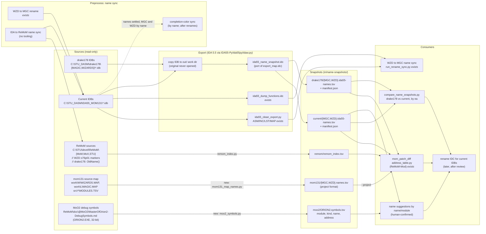

# Name Snapshot Pipeline (proposal)

Status: **draft for review, 2026-11-09.** Nothing here is implemented yet except where marked *exists*.

Goal: bring every source of Master of Magic v1.31 procedure names into Piethawn as comparable,
reproducible snapshots keyed the same way (`<EXE> <s|o><NNN>p<NN>` + IDA `ea`), so names can be mapped
between drake178's IDBs, the current IDBs, ReMoM, and BinAlgo's mom131-source-map.

## Milestones

| # | Milestone | State |
|---|---|---|
| 1 | Usable name snapshot from drake178's original IDBs | Data exists (Nov 2), made outside Piethawn; needs to be reproducible in-pipeline |
| 2 | Usable name snapshot from the current IDBs (`C:\STU_DASM\IDA55_MOM131\`) | Partial: function names are in `in/*.idb.ida55-functions.txt`; no data-item names, no `proc` key column, IDB is opened in place |
| 3 | ReMoM name extraction | Tooling *exists* in ReMoM-Mod `tools/mom_patch_diff/`; known regex gaps |
| 4 | mom131-source-map name extraction | No tooling; sources are TLINK `.MAP` publics + C sources |
| 5 | MoO2 debug-symbol names (`ORION2.EXE`) | No tooling; source is `C:\STU\devel\ReMoM\doc\@MoO2\MasterOfOrion2-DebugSymbols.md` |

## Process order

The name mapping is the last step, and it reads five snapshots. Two preprocesses come first.

1. **Preprocess: name sync.** Make MAGIC.idb, WIZARDS.idb and ReMoM agree on names.
   - The WZD-to-MGC step exists: `run_rename_sync.py` produces `ida_proc_name_sync/magic_sync_names_from_wzd.idc`.
   - The IDA-to-ReMoM step has no tooling. ReMoM-Mod's `fix_remom_ids.py` fixes id comments, not names.
2. **Separate, after step 1: completion-color sync** ([COLOR_SYNC_PROCESS.md](COLOR_SYNC_PROCESS.md); the name sync is in [NAME_SYNC_PROCESS.md](NAME_SYNC_PROCESS.md)). It copies the completed color between same-named MGC and WZD functions and reads nothing from ReMoM. It is not a preprocess for the mapping, but it depends on step 1.
   - It joins by name: `ida_proc_status_sync/status_plan.py:135` sets `join_key` to `name`, and the generated IDC finds each function with `LocByName` (`ida_proc_status_sync/generate_status_idc.py:53`).
   - It must therefore run after any rename has been applied in IDA (see [COLOR_SYNC_PROCESS.md](COLOR_SYNC_PROCESS.md), "No one-shot script").
3. **Snapshots.** Take the current IDA snapshot and the current C snapshot together, after step 1 and from the same IDB state. ReMoM's `// WZD o76p01` markers only resolve to an address through an IDA snapshot whose proc numbering matches. After a successful sync the two snapshots should agree; whatever still differs is the sync's to-do list, not an input to the mapping.
4. **Name mapping**, over the five snapshots:

| Snapshot | Frozen? | How it joins |
|---|---|---|
| drake178 IDA names | one-time (Nov 2 copy; record sha256) | IDA `ea` (same EXE) |
| Current IDA names | taken at mapping time | IDA `ea` |
| Current C names (ReMoM) | taken at mapping time, paired with the IDA snapshot | `WZD oNNNpNN` → current IDA snapshot → `ea` |
| BinAlgo C names (mom131-source-map) | **pinned**, not one-time: the repo is active (last commit 2026-10-26, uncommitted changes); record the commit hash and the `.MAP` sha256 | linker `ssss:oooo` → IDA `ea`: resident `seg + 0x1000`; overlay stub `S` → IDA `stubNNN` at `S + 0x1000` → `ovrNNN`, same offset (checked on WZD ovr076) |
| MoO2 debug-symbol names | one-time | **name and module only**: a different program, so no address or byte join |

## Data flow



## What exists today

**drake178 snapshot (milestone 1 data).** `C:\STU_DASM\drake178\export\`:

| File | Made by | Rows (incl. header) |
|---|---|---|
| `drake_magic_map.tsv`, `drake_wizards_map.tsv` | `export_map.py` / `export_map.idc` | 3079 / 8016 |
| `drake_*_addresses.tsv`, `drake_*_addresses_segments.tsv` | `map_addresses.py` (apparently) | 1283 / 4087, 53 / 157 |
| `address_table/address_table.{tsv,md}`, `remom_index.tsv` | `address_table.py`, `remom_index.py` | 5089, 1976 |

TSV header: `kind segment proc name ea size bytes`. `kind` is S (segment), F (function) or D (named
data item). `proc` is the 1-based function position within its IDA segment. In `bytes`, each relocation
fixup byte is written as `..`.

The `export_map.idc` in `C:\STU_DASM\drake178\export\tool\` matches ReMoM-Mod's
`tools/mom_patch_diff/export_map.idc` except for line endings. The two copies of `export_map.py` differ.

**Current-IDB function dump (milestone 2, partial).** `ida_proc_data_export/ida55_dump_functions.idc` writes
`<idb>.ida55-functions.txt` beside the IDB. It has names, segments, eas, colors and raw bytes. It has no
data-item names, no fixup masking, and no proc column (the proc index is derived later in
`ida55_functions_to_inventory.py`). It runs on the IDB in place; `idaw.py` backs the IDB up first.

**ReMoM (milestone 3).** These tools are in `C:\STU\devel\ReMoM-Mod\tools\mom_patch_diff\`:

| Tool | Role |
|---|---|
| `remom_index.py` | Builds the ReMoM index; columns `exe id letter segment proc function file line evidence` |
| `address_table.py` | Joins the IDA maps, ReMoM, drake178 comments and `--project NAME=TSV` |
| `link_remom.py` | Matches ReMoM ids by number, ignoring the letter |
| `fix_remom_ids.py` | Fixes id comments in ReMoM; `--apply` writes |
| `map_addresses.py`, `join_addresses.py` | Map procedures to file offsets; join two IDBs on file offset |

Known gaps:
- `address_table.py:36` `ID_COMMENT` only accepts `s`/`o`. It misses the `ovr`/`seg` spellings (about 94 markers in `.c` files).
- Some markers in ReMoM use the wrong letter.
- Proc indexes are only valid against the IDB they were exported from.

Nothing in Piethawn reads ReMoM function markers today. `dseg_map_compare.py` reads only dseg address comments.

**mom131-source-map (milestone 4).** There is no export tool.

Name sources:
- `work\W\WIZARDS.MAP` and `work\L\MAGIC.MAP`: TLINK publics, `ssss:oooo _Name`. These are git-ignored local build output.
- `src\wizards\MODULES.TSV` and `src\magic\MODULES.TSV`: code segment paragraph to source module.
- The C sources themselves.

Gaps:
- The `.MAP` files list publics only, but MoM has no non-public game functions.
  - BinAlgo's C has no `static` functions.
  - Every IDA function start converts to a MAP public, with these exceptions only:

    | Exception | WZD | MGC |
    |---|---|---|
    | `seg000` Borland C runtime internals | 58 | 46 |
    | `_AIL_` (the rebuild links AIL stand-ins) | 40 | 40 |
    | `_OVRTEXT_` overlay manager | 36 | 28 |
    | IDA "functions" in `stubNNN`, which are overlay thunks | 1318 | 157 |

  - Matched: WZD 2356 of 3808 and MGC 936 of 1207, including **all** overlay functions (checked 2026-11-10 against `in/*.idb.ida55-functions.txt`).
- Overlay functions appear at stub segments. They convert as: MAP stub `S` → IDA `stubNNN` at `S + 0x1000` → `ovrNNN`, same offset. The stub and ovr numbers paired for every overlay function in both games.
- The overlay paragraphs in BinAlgo's file headers (e.g. `ADVISORS.C` "segment 64e7") are Ghidra's. They happen to match IDA's `ovr076` at `64E7`, but the conversion uses the MAP, not the headers.
- The `re/names.tsv` that `CONVENTIONS.txt` cites is not in the repo.

**MoO2 debug symbols (milestone 5).** `C:\STU\devel\ReMoM\doc\@MoO2\MasterOfOrion2-DebugSymbols.md`
(41,292 lines) is a debug-symbol listing, one block per symbol:

```
Module: MOX
    function (0 bytes) Screen_Flic_Capture
    Address: 01:001101F0
        Num params: 0
        Return type: void (1 bytes)
```

Counts:
- 388 `Module:` lines and 8,599 `Address:` lines.
- Symbol kinds: `code` 4821, `data` 2510, `pointer` 1473, `function` 816, `char` 319, `array` 176, `struct` 132, `void` 68.
- Some `function` entries carry parameters, return types and locals.

How it can be used:
- The addresses are 32-bit `seg:offset` in ORION2.EXE, so there is no address or byte join to MoM. `Piethawn.md:147-156` finds that `Capture_Screen_Block` does the same job in both games with different code.
- It is a vocabulary source for shared MoX library code: match by name and module, with every match confirmed by a person.
- `in/ORION2.asm` (an IDA listing, Apr 12) is available for checking a candidate by hand.
- Nothing parses this file yet. A `moo2_symbols.py` would flatten it to `module kind name address params return_type`.

## Proposed diff shape (milestones 1 + 2)

New package `ida_name_snapshot/`:

| File | Change |
|---|---|
| `ida_name_snapshot/ida55_name_snapshot.idc` | New. Port of `export_map.idc`, with the same TSV columns so existing drake TSVs and `mom_patch_diff` stay compatible. The output path is `GetIdbPath() + ".ida55-names.tsv"` (Piethawn convention) instead of the `@@OUTPUT_PATH@@` placeholder. |
| `ida_name_snapshot/ida55_export_name_snapshot.py` | New thin wrapper. `--source drake178\|current` (or `--idb-dir`), `--game`, `--dry-run`, `--timeout-seconds`. It copies the `.idb` to `out/ida55-name-snapshots/work/<source>/` and refuses if unpacked parts sit beside the source. It runs the IDC on the **copy** through `IDA55-Py/ida55py/idaw.py`, verifies the TSV, then writes `in/name-snapshots/<source>/<GAME>.ida55-names.tsv` plus `<GAME>.ida55-names.manifest.json` (source path, size, mtime, sha256 of the IDB, timestamp). |
| `piethawn_sync/name_snapshot.py` | New shared loader: TSV to records `(game, kind, segment, proc, name, ea, size, bytes)`, plus `key_text()` giving `MGC s001p02` / `WZD o076p01`, identical to `mom_patch_diff`. |
| `IDA55-Py/ida55py/idaw.py` | Done (2026-11-11): `idaw.py` now takes `--backup-dir` (default `%IDA55_BACKUP_DIR%`, else the IDB's own folder) and `--ida-exe`. Pass a backup folder under `out/ida55-name-snapshots/work/` so runs on a disposable copy do not drop backups into `C:\STU_DASM\IDA55_MOM131\`. |
| `ida_name_snapshot/compare_name_snapshots.py` | New. Joins drake178 and current by `(game, ea)` with a fallback on masked bytes. Writes `out/name-snapshots/drake178-vs-current.report.{json,md}` with same / renamed / only-drake / only-current. Report only, no mutation. |
| `tests/test_ida55_name_snapshot.py` | New. Covers loader parsing, key formatting and command building, plus counterexamples: the original IDB path is never passed to IDA, and an empty TSV is rejected. |

The work does not touch `run_rename_sync.py`, the WZD-to-MGC name sync, or `ida55_dump_functions.idc`.

Validation for milestone 1: re-export drake178 with the in-repo IDC and diff it against
`C:\STU_DASM\drake178\export\drake_*_map.tsv`. The rows should be identical.

## Later (milestones 3 + 4), not in this diff

- **ReMoM.** Keep `remom_index.py` in ReMoM-Mod as the single extractor rather than re-implementing it here. Fix the `ovr`/`seg` regex gap there. Piethawn then copies the TSV into `in/name-snapshots/remom/`.
- **mom131-source-map.** Write a new `mom131_map_names.py` that parses the `.MAP` publics with `MODULES.TSV` and maps `ssss:oooo` to IDA `ea`. Resident segments map arithmetically; overlay stubs need a stub-to-ovr table. The output uses `address_table.py --project` format (`exe segment proc function file line`).
