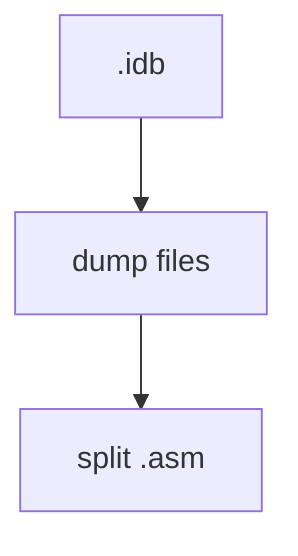
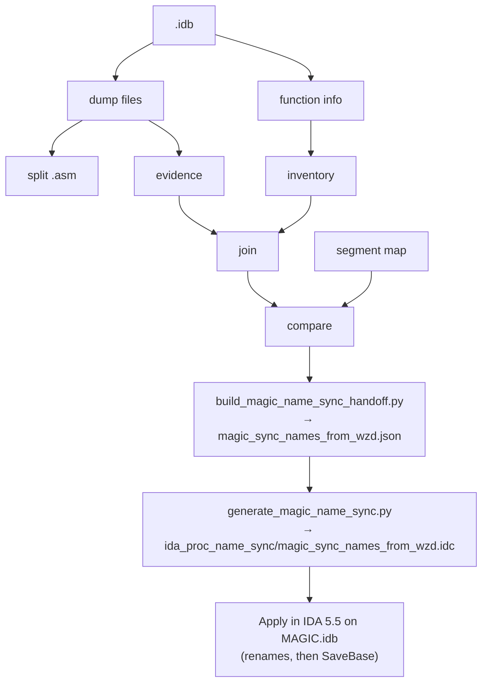

# Name Sync Process

Last checked against the code: 2026-11-10.

## Purpose

Make the names agree across the three places that hold them:

- `C:\STU_DASM\IDA55_MOM131\WIZARDS.idb` (WZD)
- `C:\STU_DASM\IDA55_MOM131\MAGIC.idb` (MGC)
- ReMoM C sources (`C:\STU\devel\ReMoM\MoM`, `\MoX`) and the TODO list generated from them

The name sync is its own process. It is a **preprocess for the name mapping** described in
[NAME_SNAPSHOT_PIPELINE.md](NAME_SNAPSHOT_PIPELINE.md): the "current IDA" and "current C" name snapshots
are taken after it. It is also a prerequisite for the color sync, described in
[COLOR_SYNC_PROCESS.md](COLOR_SYNC_PROCESS.md), because that sync matches functions by name.

## Parts

| Part | Direction | Tooling | State |
|---|---|---|---|
| A. WZD → MGC | WZD names → MGC duplicates of the same code | `run_ida55_dump_and_split.py`, then `run_rename_sync.py` | exists |
| B. IDA ↔ ReMoM | IDA names and ReMoM C names agree | none | gap |

### A. WZD → MGC (exists)

**Rule:** WZD is the naming authority and MGC is the rename target. Nothing renames WZD from MGC
(`WZD_TO_MGC_PROCEDURE_NAME_SYNC_PRD.md`). The only hand-maintained input is
`ida_proc_name_sync_prereq/MGC-vs-WZD.segment-map.json`.

**How procedures are paired:** each mapped MGC/WZD segment pair is walked by `procedure_ordinal`, the
1-based position of the procedure in its segment (`compare_procedure_evidence.py`, `procedure_key`).
Body-hash evidence is attached to each pair. Only pairs whose names differ become renames.

**Chain** (dumps and split by `run_ida55_dump_and_split.py`; inventory through IDC by `run_rename_sync.py`):





**Commands** (repo root):

```powershell
# 1. IDA dumps (ASM + function data) into in/, then the ASM split. Close every IDA window first.
c:/python314/python.exe -B .\run_ida55_dump_and_split.py
# 2. Inventory through IDC generation (no IDA)
c:/python314/python.exe -B .\run_rename_sync.py
# 3. Apply: open MAGIC.idb in the IDA GUI, File > IDC file... > ida_proc_name_sync\magic_sync_names_from_wzd.idc
```

The IDC calls `SaveBase` but not `Exit()`, so IDA stays open afterwards. A batch run through `idaw.py -A -S...`
would also stay open until you quit. `ReMoM-ReSync.md` says the script's "Exit(0) then closes IDA"; that is out
of date.

**What the IDC does** (`magic_sync_names_from_wzd.idc`):
- Looks up each old name with `LocByName`.
- Logs one of `renamed`, `already-synced`, `collision`, `name-mismatch` or `not-found`.
- Prints `magic-name-sync-summary,attempted=N,ok=N,failed=N`.
- Calls `SaveBase`.

`already-synced` counts as success, so running the IDC again is safe.

**Current numbers** (`MGC-vs-WZD.procedure-evidence-comparison.json` summary, and the handoff):

| | Count |
|---|---|
| Segment pairs | 37 |
| Procedure pairs | 668 |
| Same normalized body hash | 126 |
| Same mnemonic-sequence hash | 329 |
| Different names = renames in the handoff | 20 |

Examples of the renames: `LBX_IMG_VShiftRect → Shear_Bitmap_Y` and `Vanish_Bitmap__WIP → Vanish_Bitmap`.

**Verify:** run steps 1 and 2 again after applying. The handoff should drop to 0 renames,
or only to entries that need a decision.

### B. IDA ↔ ReMoM (gap)

No tool makes IDA names and ReMoM C names agree.

What exists nearby:
- ReMoM C functions carry id comments just above the definition (`// WZD o76p01`). That is the join key from C to IDA.
- ReMoM-Mod `tools/mom_patch_diff/fix_remom_ids.py` fixes wrong **id comments**, not names. `--apply` writes.
- ReMoM-Mod `tools/mom_patch_diff/address_table.py` reports `name_check` / `name_elsewhere` per id. That is a report of IDA-vs-ReMoM name differences, not a sync.
- `C:\STU\devel\ReMoM\tools\todolist\generate_stub_wip_todo.py` builds `stub_wip_todo.md` from ReMoM function names ending in `__STUB` / `__WIP`. The TODO list follows C names, so it follows this sync.

What a Part B tool needs to decide first, per function:
- Which side is the authority for the name (IDA, C, or a reviewed decision).
- How the `__STUB` / `__WIP` suffixes are treated. They appear in IDA names too, e.g. `Vanish_Bitmap__WIP`.
- What to do when an id comment is wrong. Run `fix_remom_ids.py` before comparing names.

Proc-index ids are only valid against the IDB state they came from. Take the IDA function export and the ReMoM scan
in the same sitting.

## Order

1. Part A: `run_ida55_dump_and_split.py` → `run_rename_sync.py` → apply the rename IDC on MAGIC.idb.
2. Part B (once tooling exists): compare IDA and ReMoM names → review → apply to whichever side is wrong.
3. Export again, so every downstream step sees the new names.
4. Then run the color sync ([COLOR_SYNC_PROCESS.md](COLOR_SYNC_PROCESS.md)) and/or take the name snapshots ([NAME_SNAPSHOT_PIPELINE.md](NAME_SNAPSHOT_PIPELINE.md)).
