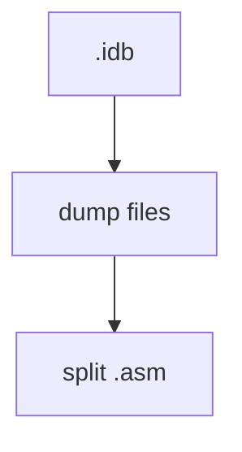
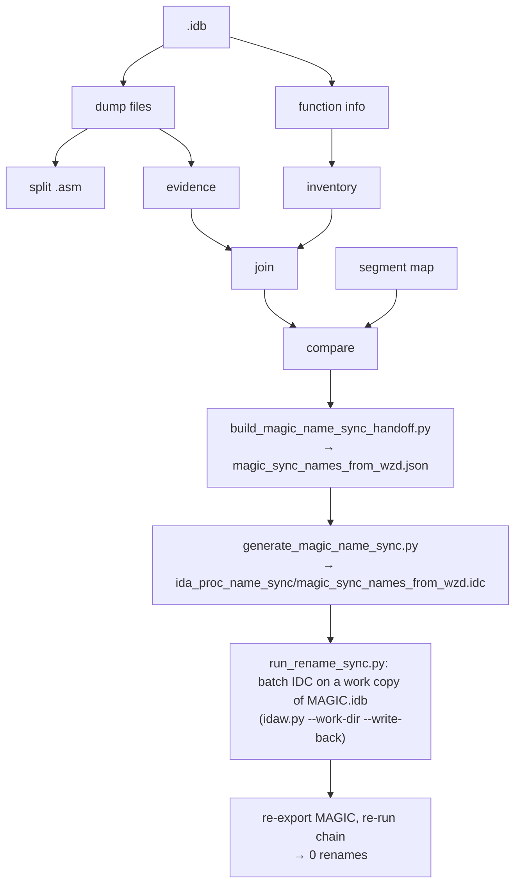

# Name Sync Process

Last checked against the code: 2026-11-10.

## Purpose

Make the names agree across the three places that hold them:

- `C:\STU_DASM\IDA55_MOM131\WIZARDS.idb` (WZD)
- `C:\STU_DASM\IDA55_MOM131\MAGIC.idb` (MGC)
- ReMoM C sources (`C:\STU\devel\ReMoM\MoM`, `\MoX`) and the TODO list generated from them

The name sync is its own process. It is a **preprocess for the name mapping** described in
[NAME_SNAPSHOT_PIPELINE.md](NAME_SNAPSHOT_PIPELINE.md): the "current IDA" and "current C" name snapshots
are taken after it. It is also a prerequisite for the color sync, described in
[COLOR_SYNC_PROCESS.md](COLOR_SYNC_PROCESS.md), because that sync matches functions by name.

## Parts

| Part | Direction | Tooling | State |
|---|---|---|---|
| A. WZD → MGC | WZD names → MGC duplicates of the same code | `run_ida55_dump_and_split.py`, then `run_rename_sync.py` | exists |
| B. ReMoM → WZD | ReMoM C names → WIZARDS.idb (then MGC through A) | `run_remom_name_sync.py` | exists |
| C. ReMoM → mom131-source-map | ReMoM C names → BinAlgo's recovered source (bridge branch) | `run_mom131_name_sync.py` | exists |

### A. WZD → MGC (exists)

**Rule:** WZD is the naming authority and MGC is the rename target. Nothing renames WZD from MGC
(`WZD_TO_MGC_PROCEDURE_NAME_SYNC_PRD.md`). The only hand-maintained input is
`ida_proc_name_sync_prereq/MGC-vs-WZD.segment-map.json`.

**How procedures are paired:** each mapped MGC/WZD segment pair is walked by `procedure_ordinal`, the
1-based position of the procedure in its segment (`compare_procedure_evidence.py`, `procedure_key`).
Body-hash evidence is attached to each pair. Only pairs whose names differ become renames.

**Chain** (dumps and split by `run_ida55_dump_and_split.py`; inventory through apply and verify by `run_rename_sync.py`):





**Commands** (repo root):

```powershell
# 1. IDA dumps (ASM + function data) into in/, then the ASM split. Close every IDA window first.
c:/python314/python.exe -B .\run_ida55_dump_and_split.py
# 2. Build the IDCs, apply them to MAGIC.idb, verify. Close every IDA window first.
c:/python314/python.exe -B .\run_rename_sync.py
#    --no-apply: stop after building the IDCs.  --no-verify: skip the re-export check.
```

**How the apply step works** (`run_rename_sync.py`, step 7):
- It is skipped when the handoff lists 0 renames, so IDA is not started at all.
- `generate_magic_name_sync.py --batch` writes `magic_sync_names_from_wzd.batch.idc`. It is the same rename logic as
  the GUI IDC, plus `Exit(0)` when every entry is `renamed` or `already-synced`, `Exit(1)` when any entry failed, and
  `Exit(2)` when `SaveBase` failed.
- `IDA55-Py/ida55py/idaw.py --work-dir out/ida55-work/MAGIC-rename-<stamp> --write-back --backup-dir C:\STU_DASM\IDA55_MOM131`
  runs it on a copy of MAGIC.idb. The real MAGIC.idb is backed up and replaced only when IDA exits with code 0, the copy
  is healthy, no IDA is running, and the real MAGIC.idb has not changed since it was copied.
- The IDA log (`out/ida55-rename-sync-logs/MAGIC-rename-<stamp>.ida.log`) must contain the summary and
  `magic-name-sync-saved`, and no `collision`, `name-mismatch`, `not-found` or `rename-failed` line.
- On any failure the real MAGIC.idb is left alone and the work folder is kept for inspection; delete it when done.

**Verify** (step 8): `ida55_export_function_data.py --game MAGIC` and `ida55_clean_export.py --game MAGIC` (both on
work copies) refresh `in/`, the chain runs again, and the handoff must list 0 renames.

The GUI IDC (`magic_sync_names_from_wzd.idc`) is still written for applying by hand: open MAGIC.idb, File > IDC file....
It calls `SaveBase` but not `Exit()`, so IDA stays open. `ReMoM-ReSync.md` says the script's "Exit(0) then closes IDA";
that is out of date.

**What the IDC does** (`magic_sync_names_from_wzd.idc`):
- Looks up each old name with `LocByName`.
- Logs one of `renamed`, `already-synced`, `collision`, `name-mismatch` or `not-found`.
- Prints `magic-name-sync-summary,attempted=N,ok=N,failed=N`.
- Calls `SaveBase`.

`already-synced` counts as success, so running the IDC again is safe.

**Current numbers** (`MGC-vs-WZD.procedure-evidence-comparison.json` summary, and the handoff):

| | Count |
|---|---|
| Segment pairs | 37 |
| Procedure pairs | 668 |
| Same normalized body hash | 126 |
| Same mnemonic-sequence hash | 329 |
| Different names = renames in the handoff | 20 |

Examples of the renames: `LBX_IMG_VShiftRect → Shear_Bitmap_Y` and `Vanish_Bitmap__WIP → Vanish_Bitmap`.

**Verify:** `run_rename_sync.py` does this itself after applying (step 8). The split `out/MAGIC/` still has the old
names until the next `run_ida55_dump_and_split.py`.

### B. ReMoM → WZD (exists)

**Rule:** ReMoM is the naming authority for WZD. WZD then stays the authority for MGC (Part A), so a ReMoM name
reaches MAGIC.idb through WIZARDS.idb.

**Join:** each ReMoM id comment (`// WZD o076p01`, just above the C definition) names IDA segment `ovr076`, procedure 1:
the 1-based position in the segment by address, the same ordinal Part A uses. `s` ids name `segNNN`. Segments IDA names
differently are mapped in `remom_name_sync/reconcile.json` `segment_aliases` (`_AIL_` = `s037`, `SOUND` = `s038`); MAGIC's are in `MGC_segment_aliases` (`_AIL_` = `s035`, `SOUND` = `s036`).
Checked on real data (2026-11-11): 1,395 of 1,630 joinable WZD ids already had the same name.

**Binding an id comment to its function** (`remom_index.scan_remom`, rules as of 2026-11-13):
- An id comment is a **tag for the function signature directly below it**. Only comments (`//` lines, `/* */`
  blocks, a one-line `/* HACK */` prefix), blank lines and preprocessor lines may come between. A multi-line signature
  is fine.
- Mark an *area* of code with BEGIN/END notes, not with the tag. A tag with code or data after it binds nothing; the
  tool never guesses past it (it once tied `o147p01` to the helper `Check_Cost`, and `o162p36` to a gd_ dumper).
  - On its own, such a tag means "no code yet" (evidence `comment`).
  - If another tag of the same id binds, it is a misplaced area tag. It is listed in the index manifest
    (`misplaced_tags`), printed by `run_mom131_name_sync.py`, and put under "Fix first" in `REMOM_TODO.md`.
- Tags are read in `.c` **and** `.h` files, on definitions and on prototypes, and **every tag of one id must name the
  same function**. Otherwise the id is `conflict?`, an `ambiguous` problem that halts the sync, with every tag listed.
  Example: `s36p08`/`s36p09` were on swapped Enable/Disable_Cancel prototypes in Fields.c against their definitions.
- A function tagged by two ids of the same EXE is also `ambiguous` (`definition?`/`prototype?`). Example: `// s13p16`
  without `WZD` in EMS.h let `// WZD s13p15` fall through to EMM_ReleaseAll__STUB's prototype.
- An ambiguous row's file:line is the **tag**, not the function, so it shows which comment to fix.
- WZD and MGC tags stacked on one signature both name it.
- Tags of one EXE on **consecutive lines** are a list (an index table, like Mouse.h's `// WZD s35p30 ...` rows), not a
  tag: none of them binds. A second tag of one EXE after a note line still replaces the first.
- `// === // WZD s01p07 ...` under an MGC id comment means "same code": the MGC id takes the WZD id's function
  (evidence `same-as`). `remom_name_sync/reconcile.json` `same_as` does the same from the Piethawn side. Check the asm
  first: MAGIC's load screen (o050p03/04/28) is *not* WIZARDS' o160p01-03.
- Mistyped id comments (`// WZD s14o03`, or `// s13p16` at column 0 with no `WZD`/`MGC`) are listed in the manifest (`malformed_ids`), printed, and put under "Fix first".

**Tooling** (`remom_name_sync/`, owned here; the scanner is copied from ReMoM-Mod `tools/mom_patch_diff`, commit f08ee954,
changed since to skip `/* */` block comments, where pasted ids and prose misled the original scanner):

| File | Does |
|---|---|
| `remom_name_sync/remom_index.py` | ReMoM snapshot → `in/name-snapshots/remom/remom_index.tsv` + `.manifest.json` (ReMoM commit) |
| `remom_name_sync/compare_remom_wzd.py` | Join, classify, validate, plan → `out/remom-name-sync/remom-vs-wzd.report.{json,md}`, `wzd_renames_from_remom.json` |
| `remom_name_sync/reconcile.json` | Hand-maintained: `segment_aliases`, and per-id `entries` (`skip`, `name`, `accept-letter`) |
| `run_remom_name_sync.py` | End to end, below |

**Command** (repo root; close every IDA window first):

```powershell
c:/python314/python.exe -B .\run_remom_name_sync.py
#    --report-only: stop after the report.  --use-existing-export: skip the WIZARDS export.
#    --no-verify / --no-mgc: skip the re-check / the WZD -> MGC follow-up.
```

Steps: export WIZARDS function data (work copy) → ReMoM snapshot → compare → **halt on problems** → write
`ida_proc_name_sync/wzd_sync_names_from_remom.idc` (GUI) and `.batch.idc` → apply with `idaw.py --work-dir --write-back`
on WIZARDS.idb → re-export and re-compare, 0 renames required → `run_rename_sync.py` (WZD → MGC).

**Halts (exit code 3)** — any of these not reconciled stops the run before IDA is started:

| Problem | Meaning | Fix in ReMoM, or reconcile |
|---|---|---|
| ambiguous | the scanner tied the id to a function another id also claims (e.g. `gd_dump_units` between comments and functions) | `skip`, or `name` |
| multiple-functions | several C functions found for one id (e.g. `X` and `X__STUB`) | `skip`, or `name` |
| no-ida-proc | the id names no WZD procedure | add a `segment_aliases` entry, or `skip` |
| wrong-letter | `s` for an overlay or `o` for a segment | `accept-letter`, or `skip` |
| invalid-name | not `[A-Za-z_][A-Za-z0-9_]*` | `name`, or `skip` |
| duplicate-target | two WZD procedures would get the same name | `skip`/`name` all but one |
| collision | the new name belongs to a WZD procedure that keeps it | rename that one in ReMoM too, or `skip`/`name` |
| temp-name-taken | a swap's temporary name `<old>__rnsync_tmp` already exists | `skip` one member |

On a halt, every problem is printed with its options, and `out/remom-name-sync/problems.reconcile-template.json`
has a ready-to-fill entry per problem (`"action": "?"`); copy the ones you decide into `reconcile.json`. Entries for ids
that no longer exist in ReMoM are reported as stale.

Handled without a halt: chains (A→B while B→C: B is renamed first) and swaps (A↔B: one side goes through
`<old>__rnsync_tmp`). `__STUB`/`__WIP` suffixes are copied as ReMoM has them. At apply time the IDC still checks each
current name, so a stale export fails as `name-mismatch` and nothing is written back.

Still in ReMoM-Mod, not copied: `fix_remom_ids.py`, `link_remom.py`, `address_table.py`.
`C:\STU\devel\ReMoM\tools\todolist\generate_stub_wip_todo.py` follows ReMoM's C names, so it is unaffected.

### C. ReMoM → mom131-source-map (exists)

**Rule:** ReMoM is the naming authority for BinAlgo's recovered source too. The renames go into a checkout of their repo:
by default the ReMoM repo's `binaryalgorithm-bridge` branch in its own worktree, `C:\STU\devel\mom131-bridge`
(`git -C C:\STU\devel\ReMoM worktree add C:\STU\devel\mom131-bridge binaryalgorithm-bridge`). ReMoM's
`tools/upstream_bridge.py` keeps that branch as their `main` + ONE bridge commit, with pushing to them disabled. Their
repo has no license: pushing the branch to a public remote republishes their work.

**Names out of mom131-source-map, from the source:** their repo is a fixed, byte-exact recreation of v1.31, so the
source says where every function is:

| Source | Gives |
|---|---|
| `src/wizards/MODULES.TSV`, `src/magic/MODULES.TSV` | each module of the program and its code segment = the IDA segment's paragraph (`4558 SAVELOAD.C` = `ovr050`) |
| `src/ail/AIL.ASM` | IDA segment `_AIL_` (not in MODULES.TSV) |
| the module's function definitions, in file order | the procedures of that IDA segment by address (Borland C++ and TASM emit code in source order) |

The procedure's position in its segment is the id ReMoM uses (`WZD o050p01`). IDA supplies only the segment layout and
the procedure starts (`in/{WIZARDS,MAGIC}.idb.ida55-functions.json`). The build's `.MAP` (`work/W/WIZARDS.MAP`,
`work/L/MAGIC.MAP`) is a check: every public function placed by source order is where the linker put it (2026-11-12:
WZD 2,076 / MGC 792 agree, 0 differ). Only AIL.ASM has more PROCs than IDA has procedures (114 to 107): its publics
are placed by the `.MAP`, the procs between two of them by order where the counts agree, and 18 internal procs stay
without an address. The repo's `re/*.tsv` tables are not used: 217 of their WZD names no longer occur in the source.

| `.MAP` | IDA |
|---|---|
| resident `ssss:oooo` | `(ssss + 1000h):oooo`, in `segNNN` / `_AIL_` / `SOUND` |
| overlay: `ssss` is a STUBSEG | `stubNNN` starts at paragraph `ssss + 1000h`; the code is in `ovrNNN` at offset `oooo` |

**The function lists and the name map** (each with a `.manifest.json`: checkout, commit, IDA export sha256):

| File | One row per | Columns |
|---|---|---|
| `in/name-snapshots/mom131/mom131_functions.tsv` | mom131 function per program it is linked into | exe, id, segment, proc, function, file, line, linkage, ida_address, map_address, ida_name, located, check |
| `in/name-snapshots/remom/remom_functions.tsv` | ReMoM function with an id comment | exe, id, segment, proc, function, file, line, evidence, ida_address, map_address, ida_name, located |
| `in/name-snapshots/mom131-remom.name-map.tsv` | procedure (both sides joined on exe + id) | exe, id, segment, proc, ida_address, map_address, ida_name, mom131_function/file/line, remom_function/file/line/evidence, names |

`names`: same, different, remom-no-code (ReMoM has only the id comment), mom131-only (no ReMoM id), remom-only. The
map is in EXE order; sort by `mom131_file` or `remom_file` to go from either source. `ida_name` is the name in the IDA
database when the export was taken.

**Programs:** WIZARDS.EXE and MAGIC.EXE are linked from one tree (`src/*/MODULES.TSV`; 48 files are in both). A function
defined in a shared module is one function: its rename applies to both programs. A function each program defines
for itself may get a different name per program (MAGIC's `Unit_Create` in `src/magic/WORLDGEN.C` is ReMoM's
`Create_Unit_NewGame`, WIZARDS' is `Create_Unit`), unless the name is also used in a shared file.

**Tooling** (`mom131_name_sync/`):

| File | Does |
|---|---|
| `mom131_name_sync/mom131_functions.py` | source + IDA export → `mom131_functions.tsv` (the `.MAP` only checks) |
| `remom_name_sync/remom_functions.py` | ReMoM id comments + IDA export → `remom_functions.tsv` |
| `mom131_name_sync/name_map.py` | joins the two → `mom131-remom.name-map.tsv` (`--use-existing`: no new scans) |
| `mom131_name_sync/mom131_names.py` | `.MAP` reading and address conversion (used by the check) |
| `mom131_name_sync/programs.py` | which program(s) link each source file (MODULES.TSV, includes, `src/ail`, `WIZDECL.H`/`MAGDECL.H`) |
| `mom131_name_sync/compare_mom131_remom.py` | join with the ReMoM snapshot, classify, validate → `out/mom131-name-sync/` report, `mom131_renames_from_remom.json` |
| `mom131_name_sync/apply_mom131_renames.py` | whole-word renames in every tracked text file; never inside string literals |
| `mom131_name_sync/reconcile.json` | hand-maintained per-id `entries`: `skip`, or `name` |
| `run_mom131_name_sync.py` | end to end, below |

**Command** (repo root; the IDA exports in `in/` must be current, see Part A step 1):

```powershell
c:/python314/python.exe -B .\run_mom131_name_sync.py
#    --report-only: stop after the report (the function lists and the name map are written).
#    --no-verify: skip the rebuild check.  --commit: fold the renames into the bridge commit.
```

Steps: mom131 functions → ReMoM functions → name map → compare → **halt on problems** → apply (the checkout must have no
uncommitted changes) → build again, **both EXEs must stay identical to v1.31** (names are not in the EXE bytes; a string
literal is never renamed) → lists, map and compare again, 0 renames must remain (the map then has the new names) → `--commit`: `upstream_bridge.py commit`.
On a failed verify the renamed checkout is kept; `git -C C:\STU\devel\mom131-bridge checkout -- .` undoes it.

**Halts (exit code 3):**

| Problem | Meaning | Fix in ReMoM, or reconcile |
|---|---|---|
| ambiguous | ReMoM's scanner tied the id to a function another id also claims | `skip`, or `name` |
| multiple-functions | several ReMoM functions for the id | `skip`, or `name` |
| invalid-name | not a C identifier | `name`, or `skip` |
| not-in-source | the mom131 name is not in the source's code (a function list older than the source) | rerun |
| conflicting-targets | ids disagree about one function, or a name used in a shared file would differ between WZD and MGC | make ReMoM agree, or `skip`/`name` |
| duplicate-target | two functions of one program would get the same name | `skip`/`name` all but one |
| collision | the new name is already an identifier in the program's code that stays | `name`, or `skip` |
| significance-clash | the new name and another identifier agree in their first 32 characters (`-i32`) | `name` (shorter), or `skip` |
| library-name | the new name is a C keyword or a name in the code of the Borland C++ 3.1 headers the source includes (`_fstrcpy` in `STRING.H`; comments and headers no module includes do not count) | `name`, or `skip` |

**Twins.** A function in a file both programs link is one definition with a WZD and an MGC id; ReMoM often tags only
one. The report counts it once: the other id is `twin` (renamed with it), `twin-no-code` or `twin-no-remom`, so
`no-code` and `no-remom` count functions. The name map shows the twin's ReMoM name with `remom_via` = its id.

**Outside the source** (docs, `tools/`, `re/`, `index.html`) a name with one meaning is renamed everywhere. A name the
two programs rename differently (`Unit_Create`: WZD `Create_Unit`, MGC `Create_Unit_NewGame`) is decided per mention:
`re/magic_names.tsv` and `re/current_MAGIC/` are MGC, `re/names.tsv` and `re/current_WIZARDS/` WZD; else the nearest
IDA address within 80 characters that is one program's definition (`Unit_Create (4358:95d5)`); else a `mentions`
entry of `mom131_name_sync/reconcile.json` (`file`, `name`, `near` = text within 120 characters, `program` WZD / MGC /
`keep`); else MAGIC / WIZARDS in the file name or alone on the line. Undecided mentions are left and printed with
file:line; add a `mentions` entry for each.

The `.MAP` check is skipped when the `.MAP` is not from this source (a public C function of the source is missing from
it): build/build.py dates its output 1995-03-03, so file times cannot tell.

## Order

1. Part B: `run_remom_name_sync.py` (it ends by running Part A, `run_rename_sync.py`, so MGC follows).
2. Part A alone, when only WZD/MGC changed: `run_ida55_dump_and_split.py` → `run_rename_sync.py`.
3. `run_ida55_dump_and_split.py` again, so `in/*.asm` and the split `out/` see the new names.
4. Part C: `run_mom131_name_sync.py`, after the IDA exports in `in/` are current.
5. Then run the color sync ([COLOR_SYNC_PROCESS.md](COLOR_SYNC_PROCESS.md)) and/or take the name snapshots ([NAME_SNAPSHOT_PIPELINE.md](NAME_SNAPSHOT_PIPELINE.md)).
